# 캠퍼스 다이어리 · 웹 프로그래밍 4–7주차

가톨릭대학교 성심교정에서 지내는 유학생의 캠퍼스 생활을 주제로 만든 웹 프로그래밍 과제 모음입니다.

- 과제 모음 (GitHub Pages): https://liangwanqi1016-dot.github.io/liangwanqi.github/
- 저장소: https://github.com/liangwanqi1016-dot/liangwanqi.github

| 주차 | 내용 | 주소 |
| --- | --- | --- |
| 4주차 실습 1 | 장소 탐험 (버튼 → 설명·Google 지도 전환) | https://liangwanqi1016-dot.github.io/liangwanqi.github/campus/map.html |
| 4주차 실습 2 | Google Trends 검색 관심도 (DJI / Insta360) | https://liangwanqi1016-dot.github.io/liangwanqi.github/stats/ |
| 4주차 실습 3 | Canvas 게임 (별 먹는 캠퍼스 뱀) | https://liangwanqi1016-dot.github.io/liangwanqi.github/game/ |
| 5주차 | 음식 취향 밸런스 게임 | https://liangwanqi1016-dot.github.io/liangwanqi.github/food/ |
| 6주차 실습 1 | 이미지 처리 (Render) | https://campus-image-week6.onrender.com/image |
| 6주차 실습 2 | 서버 TTS (로컬 실행, 시연용 Render 추가 배포) | https://campus-tts-week6.onrender.com/tts |
| 7주차 | 캠퍼스 한 끼 게시판 (Render) | https://campus-meal-week7.onrender.com/ |

모든 페이지는 오른쪽 위에서 한국어 · 中文 · English로 바꿀 수 있고, 고른 언어는 `localStorage`의 `campus.language`에 저장되어 다른 페이지에서도 이어집니다.

Render 무료 서버는 쉬고 있다가 첫 접속 때 깨어나므로 처음 열 때 30초 정도 걸릴 수 있습니다.

## 폴더 구조

```text
/                 과제 모음 첫 화면 (index.html)
├── campus/       2–3주차 캠퍼스 소개 + 4주차 장소 탐험(map.html)
├── stats/        4주차 공개 데이터 시각화 (data/ 에 CSV, vendor/ 에 Papa Parse·Chart.js)
├── game/         4주차 Canvas 게임
├── food/         5주차 음식 취향 테스트
├── lab/ image/ tts/   6주차 Render 앱으로 들어가는 GitHub Pages 입구
├── board/        7주차 게시판 입구 (Render로 연결)
├── 网页/week6/   6주차 Flask 소스 (Render 배포 대상)
├── 网页/week7/   7주차 Flask 소스 (Render 배포 대상)
└── screenshots/  실행 화면
```

GitHub Pages에서 보이는 4·5주차 화면은 최상위 폴더(`campus/`, `stats/`, `game/`, `food/`)가 최신 버전입니다. `网页/week2-3`~`week5`는 이전 단계 기록입니다.

---

## 4주차

### 실습 1 · 장소 탐험

- 주소: https://liangwanqi1016-dot.github.io/liangwanqi.github/campus/map.html
- 수정한 부분: 2주차의 세 장소(중앙도서관, B333 교실, 운동장)의 사진·설명·추천 이유를 section 세 개로 넣고, 장소 데이터(`campus/campus.js`의 `places`)와 지도 검색어, 색과 간격을 바꿨습니다.
- 클릭 → 지도 변경 흐름
  1. 장소 버튼(`data-place`)을 누르면 `selectPlace(id)`가 실행됩니다.
  2. 모든 `.map-place` section에 `hidden`을 주고, 선택한 장소의 section만 보이게 합니다.
  3. 같은 함수에서 Google 지도 iframe의 `src`, 지도 제목, Naver·Google 외부 링크를 선택한 장소로 바꿉니다.
  4. 버튼의 `aria-pressed`로 현재 선택을 표시하고, 주소의 `#class` 같은 해시로 새로고침 후에도 같은 장소를 엽니다.
  5. 첫 접속 때는 중앙도서관이 선택된 상태입니다. 페이지 이동 없이 DOM만 바뀝니다.
- 연결: 장소 탐험 → 통계·게임 링크, 통계·게임 → 장소 탐험 링크를 넣었습니다.
- 모바일: 버튼·설명·지도가 세로로 이어지고, 넓은 화면에서는 설명과 지도가 나란히 보입니다.

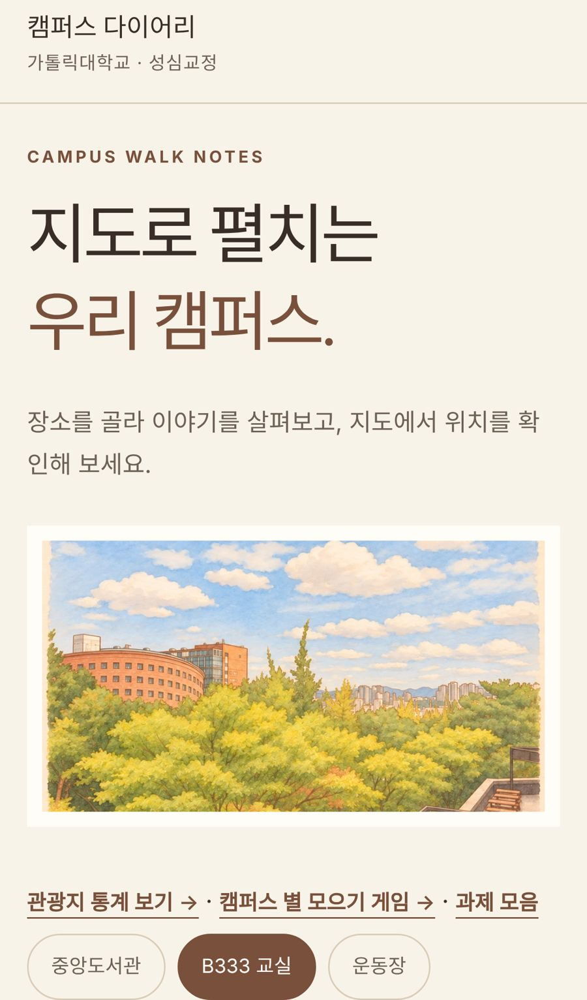

### 실습 2 · Google Trends 공개 CSV 시각화 (2026-11-27 수정)

- 주소: https://liangwanqi1016-dot.github.io/liangwanqi.github/stats/
- **첫 번째 브랜드 막대그래프와 두 번째 대분류 꺾은선 그래프**, 탭·필터·배치·세 언어를 유지하고 관심 있는 영상 브랜드 데이터로 교체했습니다.
- 데이터 ①: `DJI`와 `Insta360`, Worldwide / Web Search / All categories / 2025-01-01–2025-12-31. 주 시작일이 2025년인 52주의 평균을 첫 막대그래프에서 비교합니다. 평균 지수는 DJI 74.69, Insta360 11.79이고 DJI 최고 주는 2025-11-23(100)입니다.
- 데이터 ② (대분류로 변경): 액션 카메라 / 핸드헬드 카메라 / 드론 / 360도 카메라 / 스마트폰 짐벌. 대표 검색어는 각각 `DJI Osmo Action`, `DJI Osmo Pocket`, `DJI drone`, `DJI Osmo 360`, `DJI Osmo Mobile`입니다. 같은 비교 요청에서 새 원본을 내려받아 주 시작일의 월별 평균을 계산했습니다. 원래 Osmo/Mini/Mavic/Ronin/Air 수치의 이름만 바꾼 것이 아닙니다.
- CSV는 페이지에서 Papa Parse로 실제 읽습니다. `stats/data/brand-interest-weekly-2025.csv`, `stats/data/dji-categories-monthly-2025.csv`와 원본 2개, 출처·정리 방법 `stats/data/README.md`를 함께 제공합니다. 같은 자료를 `网页/week4/data/`에도 보관합니다.
- 두 원본은 53주이며 2024-12-29 행을 계산에서 제외했습니다. 월평균은 일별 가중 평균이 아닙니다. 빈 값·잘못된 숫자·중복 기간을 검증하고 누락을 0으로 바꾸지 않습니다. 잘못된 파일은 오류를 안내합니다.
- **지수 0–100은 검색 관심도이며 검색 건수·사람 수·판매량·매출·시장점유율이 아닙니다.** 두 CSV는 별도 비교 요청에서 각각 정규화되어 서로 직접 비교하지 않습니다. 각 대분류는 대표 검색어 하나로 측정하며, 카테고리 전체 검색량·모든 모델의 합계나 DJI 전 제품을 대표하지 않습니다. 출시가 변화의 원인이라는 주장은 하지 않습니다.
| | 그래프 ① | 그래프 ② |
| --- | --- | --- |
| 질문 | 2025년 한 해 동안 DJI와 Insta360 중 어느 브랜드의 검색 관심도가 더 높았을까? | DJI 대분류(액션·핸드헬드·드론·360도·짐벌)의 대표 검색어는 월별로 어떻게 달라질까? |
| CSV | `brand-interest-weekly-2025.csv` (52행) | `dji-categories-monthly-2025.csv` (12행) |
| 사용한 열 | `week`, `DJI`, `Insta360` | `month`, 대분류 검색어 5열 |
| 집계 | 브랜드별 52주 평균 | 주 시작일의 월별 단순 평균 |
| 형식 | 막대그래프 | 꺾은선 그래프 |
| 형식 선택 이유 | 두 브랜드의 한 해 평균 크기를 나란히 비교 | 12개월의 오르내림과 대분류 간 흐름을 비교 |
| 필터 | 표시할 항목(전체/DJI/Insta360) | 표시할 항목(전체/대분류 하나) |

- 오류 처리 확인(브라우저에서 CSV 응답을 바꿔 시험): 빈 파일·머리글만 있는 파일 → “CSV에 데이터 행이 없습니다.”, 숫자가 아닌 값·필요한 열 없음 → “CSV 형식이 올바르지 않습니다…”, 파일 없음(404) → “CSV 파일을 불러오지 못했습니다…”. 세 언어로 표시됩니다.
- 탭: 버튼 두 개, 처음에는 ①만 보이고 누른 탭만 `aria-selected="true"`, 나머지 패널은 `hidden`입니다. 숨어 있던 그래프는 보일 때 크기를 다시 계산합니다.
- 모바일: 390px 폭에서 가로 스크롤 없이 두 탭의 그래프·범례·버튼·해석이 보이는 것을 확인했습니다.
- [브랜드 원출처](https://trends.google.com/trends/explore?date=2025-01-01%202025-12-31&q=DJI,Insta360&hl=en)
- [제품군 원출처](https://trends.google.com/trends/explore?date=2025-01-01%202025-12-31&q=DJI%20Osmo%20Action,DJI%20Osmo%20Pocket,DJI%20drone,DJI%20Osmo%20360,DJI%20Osmo%20Mobile&hl=en)
- 라이브러리와 라이선스 파일은 기존 `vendor/`를 유지합니다. 원본 데이터에 이용자 개인 정보는 포함하지 않습니다.

### 실습 3 · Canvas 게임 「별 먹는 캠퍼스 뱀」

- 주소: https://liangwanqi1016-dot.github.io/liangwanqi.github/game/
- 별을 먹는 주제를 유지하고 조작을 **뱀 이동 게임**으로 바꿨습니다. 별마다 1점·몸 1칸 증가, 12개를 먹으면 성공합니다. 벽이나 자기 몸에 닿으면 종료합니다.
- Canvas 600×420을 20×14칸으로 나누고 입력 방향 → 다음 머리 위치 → 충돌 → 성장/별 재배치 순서로 처리합니다. 별은 몸과 겹치지 않는 칸에 생성합니다.
- PC 방향키/WASD, 휴대폰 스와이프·방향 버튼, 일시정지/계속하기, 다시 시작/초기화를 제공합니다. 즉시 반대 방향과 한 이동 주기 내 여러 회전을 막았습니다.
- 제한 시간 대신 경과 시간을 표시합니다. 별을 먹으면 조금 빨라집니다(270ms에서 최소 140ms). 최고 기록은 현재 페이지의 변수에만 저장합니다. 탭 전환·페이지 이탈 시 자동 일시정지합니다.
- 따뜻한 색상·캠퍼스 삽화 배경과 한국어·中文·English, 기존 지도·통계·과제 모음 링크를 유지했습니다.
- 검증: 성장·별 위치·반대 방향 차단·벽/몸/움직이는 꼬리 충돌·12점 완료·일시정지/계속·스와이프·재시작·3개 언어를 로직 테스트로 확인했습니다. 실제 휴대폰 기종별 검증은 별도로 필요합니다.
- AI 도움: “먹는 별을 유지하면서 뱀처럼 이동하는 방식으로 바꾸기”를 요청하고, 타이머 중복·입력·충돌과 재시작을 확인했습니다.

## 5주차 · 음식 취향 테스트 「나의 푸드 스타일」

- 주소: https://liangwanqi1016-dot.github.io/liangwanqi.github/food/
- 소개: 수업 사이 “오늘 뭐 먹지?” 고민을 8문항 양자택일로 풀어 보는 테스트입니다.
- 대상과 주제를 고른 이유: 같은 학교 친구들과 유학생. 매일 하는 고민이라 누구나 쉽게 답할 수 있고, 결과로 이야기를 나누기 좋습니다.

### 질문과 결과

기본 예제를 쓰지 않고 8문항 모두 직접 만들었습니다.

| # | 질문 | A | B |
| --- | --- | --- | --- |
| 1 | 친구가 밥 먹으러 가자고 하면? | 3년째 단골집 (OLD) | 인스타에서 본 새 식당 (NEW) |
| 2 | 찌개/전골 먹을 때? | 매운 거 없으면 안 돼 (SPICY) | 담백한 게 좋아 (MILD) |
| 3 | 혼밥할 때 보통? | 배달 시켜놓고 천천히 (SLOW) | 편의점에서 15분 만에 (FAST) |
| 4 | 친구가 한턱 쏜다고 하면? | 일주일 전부터 메뉴 정함 (OLD) | 가서 분위기 보고 정함 (NEW) |
| 5 | 카페에서 뭐 마실래? | 달달한 밀크티 (SPICY) | 아메리카노/허브티 (MILD) |
| 6 | 주말에 시간 생기면? | 집에서 해먹기 (SLOW) | 동네 탐방하며 먹기 (FAST) |
| 7 | 밥 먹을 때 첫 입은? | 밥부터 (OLD) | 반찬/고기부터 (NEW) |
| 8 | 다이어트 중 배가 고프면? | 일단 먹고 생각 (SPICY) | 참고 물 마심 (MILD) |

- 결과 분류 규칙: OLD/NEW 3문항, SPICY/MILD 3문항의 선택 수를 세어 두 축으로 결과를 정합니다.
  - 🌶️ 매운맛 고인물 = OLD + SPICY
  - 🍵 담백한 힐링 푸디 = OLD + MILD
  - 🔥 찐뉴 트렌드 푸디 = NEW + SPICY
  - 🥗 요즘 감성 건강 푸디 = NEW + MILD
- 동점 처리: 각 축이 3문항(홀수)이라 동점이 나오지 않지만, 코드에서는 `>=`로 OLD·SPICY를 우선합니다.
- 나만의 표현: 결과 카드 아래 **식사 템포 배지**. 3·6번(SLOW/FAST) 답으로 “🍽️ 천천히 음미하는 타입 / ⚡ 빠르게 해결하는 타입 / ⚖️ 그날그날 달라요”를 보여 줍니다. 구현 위치: `food/food.js`의 `calcPace()`와 `renderResult()`, `food/index.html`의 `#r-pace`. 한국어·중국어·영어 세 언어를 지원합니다.

### 저장 설계

| 저장소 | 키 | 값 | 이유 |
| --- | --- | --- | --- |
| sessionStorage | `week5.draft` | `{nickname, index, answers}` | 답하던 중인 상태는 같은 탭에서만 이어지면 충분하고, 탭을 닫으면 사라지는 게 자연스러움 |
| localStorage | `week5.history` | `[{nickname, result, resultKey, emoji, time}]` 최대 20개 | 완료 기록은 페이지를 다시 열어도 남아야 함 |

- 조회: 첫 화면 “나의 취향 기록” 목록. **“내 저장 데이터 보기”** 버튼은 누른 시점에 두 저장소를 다시 읽어 JSON으로 보여 줍니다.
- 개별 삭제: 기록마다 “삭제” 버튼 → 그 `time`의 기록만 지우고 저장 후 목록을 다시 그립니다.
- 전체 삭제: “전체 기록 삭제” → `localStorage.removeItem('week5.history')`. 다른 주차 데이터를 지우지 않도록 `localStorage.clear()`는 쓰지 않습니다. 초안은 “초안 삭제”로 따로 지웁니다.
- 저장할 때는 `JSON.stringify()`, 읽을 때는 `JSON.parse()`를 씁니다. 저장소에는 문자열만 들어가기 때문입니다.

### 확인 결과

- 브라우저: Chrome(데스크톱), 휴대폰 크기 화면.
- 새로고침: 2문항 답한 뒤 새로고침 → “진행 중인 테스트: …님, 2문항 완료” 배너 → 이어서 하기 → 3번 문항부터 계속.
- 새 탭: 초안은 보이지 않고(sessionStorage는 탭마다 따로), 완료 기록은 보입니다(localStorage).
- 탭 닫기 후 다시 열기: 초안은 사라지고 완료 기록은 남아 있습니다.
- 중복 저장: 같은 별명의 기록이 30초 안에 또 들어오면 저장하지 않습니다.
- 잘못된 데이터: 개발자 도구에서 값을 깨진 JSON이나 다른 자료형으로 바꿔도 `parse()`가 기본값으로 처리하고, 형식이 맞지 않는 기록은 걸러 냅니다.
- 삭제 후 재방문: 개별·전체 삭제 후 새로고침해도 지운 기록이 돌아오지 않습니다.
- 브라우저 값을 믿을 수 없는 이유: 사용자가 개발자 도구로 언제든 바꿀 수 있기 때문입니다. 그래서 읽을 때마다 형식을 검사하고, 별명 같은 값은 `textContent`로 표시해 `<b>test</b>`를 넣어도 태그가 실행되지 않고 글자로 보입니다.

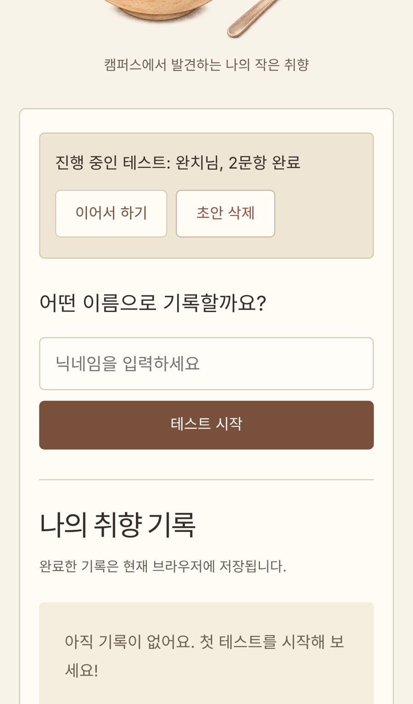
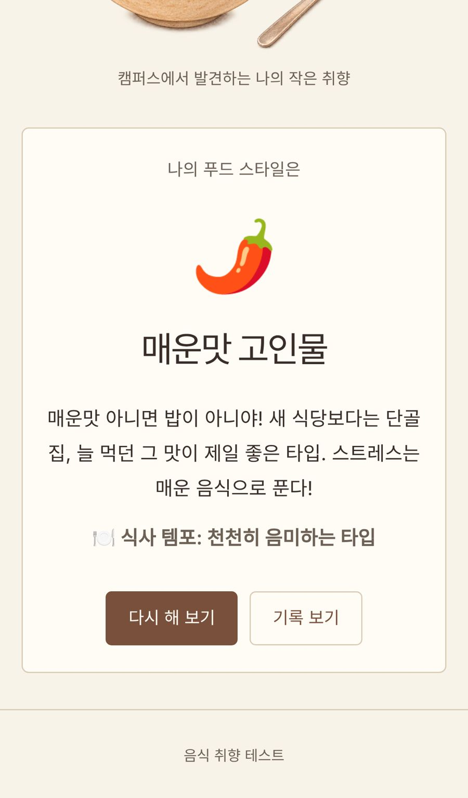
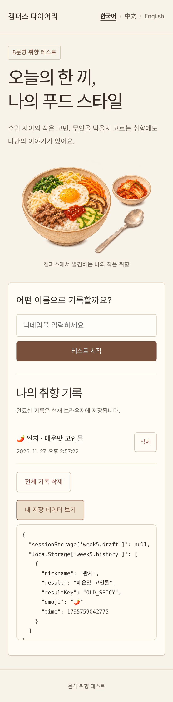

---

## 6주차

### 실습 1 · 이미지 처리 (Render)

- Render 주소: https://campus-image-week6.onrender.com/image (입구: https://campus-image-week6.onrender.com/hello)
- Render 설정: Root Directory는 6주차 소스 폴더(Render 설정 화면의 값), Build `pip install -r requirements.txt`, Start `gunicorn app:app --bind 0.0.0.0:$PORT --workers 1 --threads 2 --timeout 120`, `PYTHON_VERSION=3.12.12`, Health Check Path `/health`, Free 인스턴스.
- 내가 수정한 내용: 캠퍼스 다이어리 디자인(미색 배경, 갈색 버튼), 이름을 입력하는 환영 화면(`/hello`), 한국어·중국어·영어 전환, 원본과 결과를 나란히 보는 배치(700px 이하에서는 한 열).
- 브라우저가 보내는 값: `POST /api/process`, `FormData` — `image`(JPEG/PNG/WebP 파일), `operation`(`grayscale`/`blur`/`edge`), `kernel`(3–51 홀수).
- 서버가 돌려주는 값: 결과 PNG(`image/png`)와 헤더 `X-Compute-Ms`(알고리즘 시간), `X-Processing-Ms`(서버 전체 처리 시간), `X-Image-Size`(결과 크기). 오류는 JSON `{"error": "..."}`.
- 화면 순서: 원본만 표시 → “Processing...” → 결과와 시간 표시.

세 처리 방법 결과 (휴대폰 크기 화면, Render 주소에서 직접 업로드):

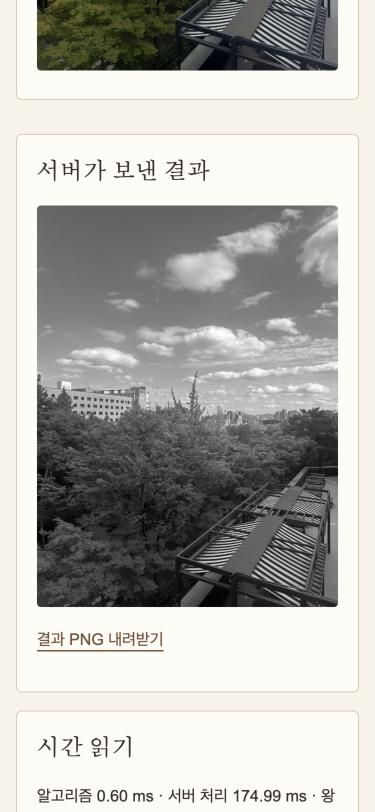
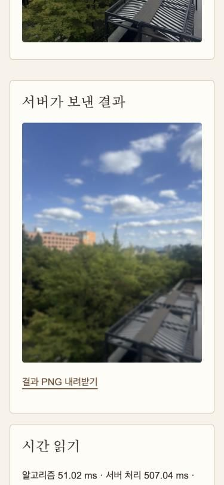
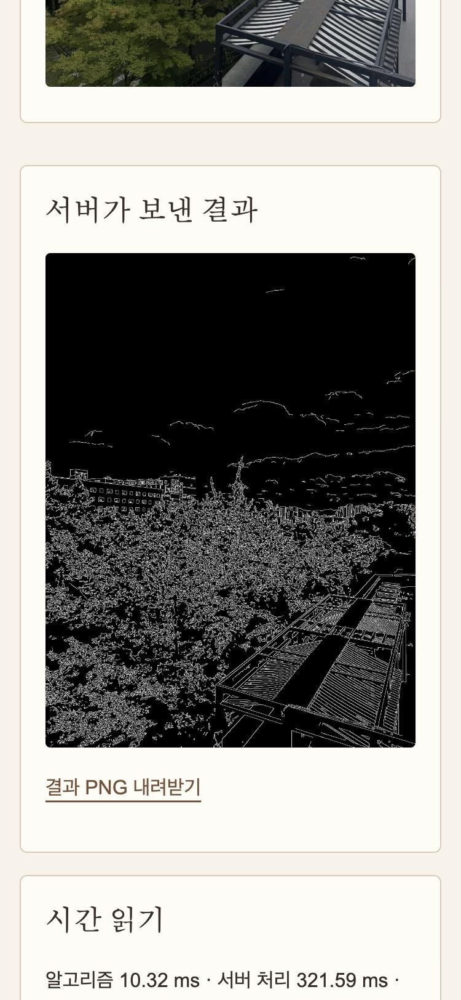

시간 측정 (Render, 2026-11-27, 각 3회 측정의 중앙값, 단위 ms):

| 바꾼 값 | 이미지 크기 | 처리 | kernel | 알고리즘 | 서버 처리 | 왕복 |
| --- | --- | --- | --- | --- | --- | --- |
| 크기 | 400×300 | blur | 15 | 1.31 | 8.1 | 272 |
| 크기 | 800×600 | blur | 15 | 2.32 | 203.3 | 528 |
| 크기 | 1600×1200 | blur | 15 | 93.86 | 819.5 | 1645 |
| kernel | 800×600 | blur | 3 | 0.73 | 152.5 | 587 |
| kernel | 800×600 | blur | 15 | 2.50 | 167.4 | 520 |
| kernel | 800×600 | blur | 31 | 6.27 | 98.1 | 495 |
| kernel | 800×600 | blur | 51 | 51.15 | 303.1 | 696 |
| 처리 방법 | 800×600 | grayscale | – | 0.19 | 92.8 | 353 |
| 처리 방법 | 800×600 | edge | – | 1.47 | 28.6 | 227 |

- 해석: 이미지가 커지고 kernel이 커질수록 알고리즘 시간이 늘었습니다(1600×1200은 400×300보다 약 70배). 서버 처리 시간에는 파일 읽기·검사·PNG 인코딩이 들어가고, 왕복 시간에는 업로드·다운로드와 네트워크가 더해져서 항상 가장 깁니다. 무료 서버라 측정할 때마다 값이 흔들립니다.

오류 응답 확인:

| 요청 | 응답 |
| --- | --- |
| kernel 4 (짝수) | 400 |
| 지원하지 않는 처리 방법 | 400 |
| 파일 없이 전송 | 400 |
| 이미지가 아닌 파일 | 400 |
| 6.5 MiB 파일 | 413 |
| `GET /api/process` | 405 |
| 없는 주소 | 404 |

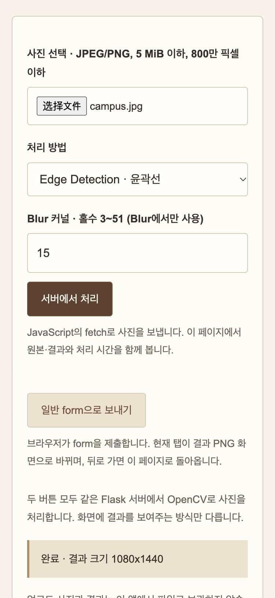

### 실습 2 · 서버 TTS

- 실행 명령 (로컬):

```sh
cd 网页/week6
python -m pip install -r requirements-tts.txt
python -m piper.download_voices en_US-lessac-low --download-dir models
python -m flask --app tts_app run --debug --port 5000
```

- 로컬 주소: http://127.0.0.1:5000/tts (시연용으로 https://campus-tts-week6.onrender.com/tts 에도 추가 배포)
- 모델: Piper `en_US-lessac-low`, 영어(미국), 출처 https://huggingface.co/rhasspy/piper-voices (모델 카드: en/en_US/lessac/low/MODEL_CARD). 모델 파일은 `.gitignore`로 저장소에 올리지 않습니다.
- 사용 상황: 캠퍼스를 처음 찾은 외국인 친구에게 장소 안내 문장을 영어 음성으로 들려주기.
- 추가한 요소: 읽기 속도 선택(느리게 1.25 / 보통 1.0 / 빠르게 0.8), 재생, WAV 내려받기.
- 흐름: 문장 입력 → Generate Speech → 처리 중 표시 → JSON으로 `POST /api/tts` → 서버의 Piper가 WAV 생성 → `audio/wav` 응답 → `Blob`과 `AudioContext`로 분석 → Canvas에 파형 표시.

서로 다른 두 문장 비교 (2026-11-27 측정):

| 문장 | 서버 생성 시간 | 음성 길이 | WAV 크기 |
| --- | --- | --- | --- |
| Welcome to our campus library. | 5872.1 ms | 2.14 s | 67.0 KiB |
| After class, let us walk to the sports field and enjoy the autumn festival together. | 11690.4 ms | 4.85 s | 151.5 KiB |

문장이 길수록 음성 길이와 WAV 크기가 늘고, 파형의 모양도 다릅니다. 같은 긴 문장을 속도 1.25(느리게)로 만들면 약 4.8 s에서 5.33 s로 길어졌습니다.

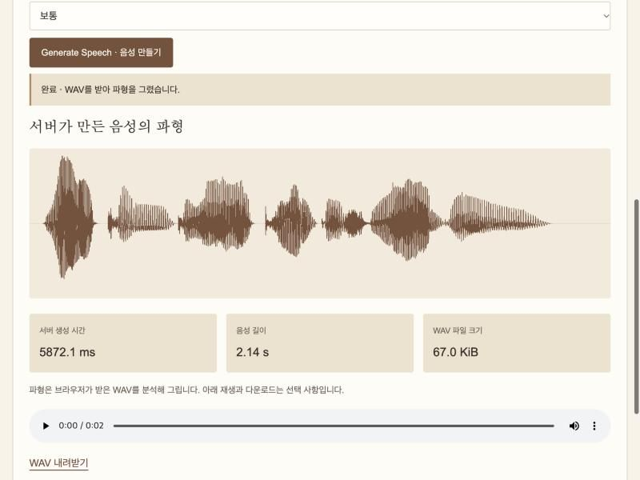
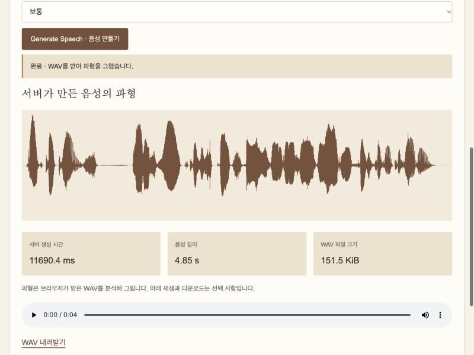

요청·응답 확인 기록:

- 정상: `POST /api/tts`, 요청 본문 `{"text": "...", "length_scale": 1.0}`, 응답 200 `audio/wav`.
- 빈 문장, 300자 초과: 400 “1~300자의 영어 문장을 입력하세요.”
- 한국어 등 지원하지 않는 언어: 400 “기본 모델은 영어용입니다.”
- 잘못된 속도 값: 400.
- 모델이 없을 때: 503 “모델과 설정 파일이 없습니다. 수업 자료의 모델 다운로드 단계를 실행하세요.” (모델 없이 로컬 실행해 확인)
- 중복 클릭: 생성 중에는 버튼과 입력이 잠기고, 서버도 동시에 두 요청이 오면 429로 막습니다.
- 브라우저 내장 `speechSynthesis`나 미리 만든 WAV는 쓰지 않습니다.

---

## 7주차 · 캠퍼스 한 끼 게시판

- 주제: 캠퍼스 한 끼 추천 — “학교 근처에서 친구에게 추천하고 싶은 한 끼는 무엇인가요?”
- Render: https://campus-meal-week7.onrender.com/ (관리 화면 `/admin`, 관리자 로그인 필요)
- 수정한 파일: `app.py`(`BOARD_TITLE`, `BOARD_QUESTION`, `/health`), `templates/comments.html`·`welcome.html`·`auth.html`·`admin.html`(문구, 공통 로그인 입구, 연습 데이터 패널), `static/style.css` 등(크림색·갈색 테마, 한식 일러스트).
- 계정·권한·CSRF 검사와 DB 구조(`schema.sql`)는 수업 코드 그대로 유지했습니다.

### 로컬 실행

```sh
cd 网页/week7
export SECRET_KEY="$(python -c 'import secrets; print(secrets.token_hex(32))')"
python -m flask --app app init-db
python -m flask --app app run --debug --port 5000
```

관리자 지정: `export WEEK7_ADMIN_USERNAME=<관리자 아이디>` 후 `python -m flask --app app promote-admin`.

### 저장 방식 비교 (`mini_storage.py`)

같은 문장을 Python 리스트, JSON 파일, SQLite DB에 넣고 두 번 실행했습니다.

| 실행 | Python 리스트 | JSON 파일 | SQLite DB |
| --- | --- | --- | --- |
| 1번째 | 1개 | 1개 | 1개 |
| 2번째 | 1개 | 2개 | 2개 |

리스트는 메모리에만 있어서 프로그램이 끝나면 사라지고, JSON 파일과 SQLite는 디스크에 남아 다시 실행해도 이어집니다.

### 확인 결과 (두 계정, 서로 다른 브라우저)

| 확인 항목 | 결과 |
| --- | --- |
| 중복 아이디 가입 | 400 거부 |
| 잘못된 비밀번호 | 401 거부 |
| 두 계정이 같은 글 목록을 봄 | 확인 |
| 남의 글 삭제 요청 | 403 |
| `<script>alert(1)</script>` 입력 | 실행되지 않고 글자로 표시 |
| CSRF 값 없는 POST | 400 |
| 일반 계정 `/admin` | 403 |
| 남의 글 신고 / 같은 글 중복 신고 / 자기 글 신고 | 성공 / 400 / 400 |
| 서버 재시작 후 | 글 유지 (SQLite `instance/app.db`) |

### 관리 기능 시험

1. 관리자 화면의 **“연습 계정·글 무작위 생성”**으로 연습 계정 2개(`test_a_…`, `test_b_…`)와 `[연습]` 글 4개를 만들었습니다. 생성된 아이디와 공통 비밀번호는 그 화면에 한 번만 표시됩니다.
2. 연습 계정으로 로그인해 다른 계정의 글을 신고했습니다.
3. 관리자가 “신고된 글만 보기”로 신고 1건을 확인하고, 내용 검색(“김치찌개”), 글 삭제, 계정 차단·차단 해제를 시험했습니다.
4. **“연습 데이터 모두 삭제”** 후 연습 계정과 `[연습]` 글만 사라지고, 직접 만든 계정과 글은 남아 있는 것을 확인했습니다.

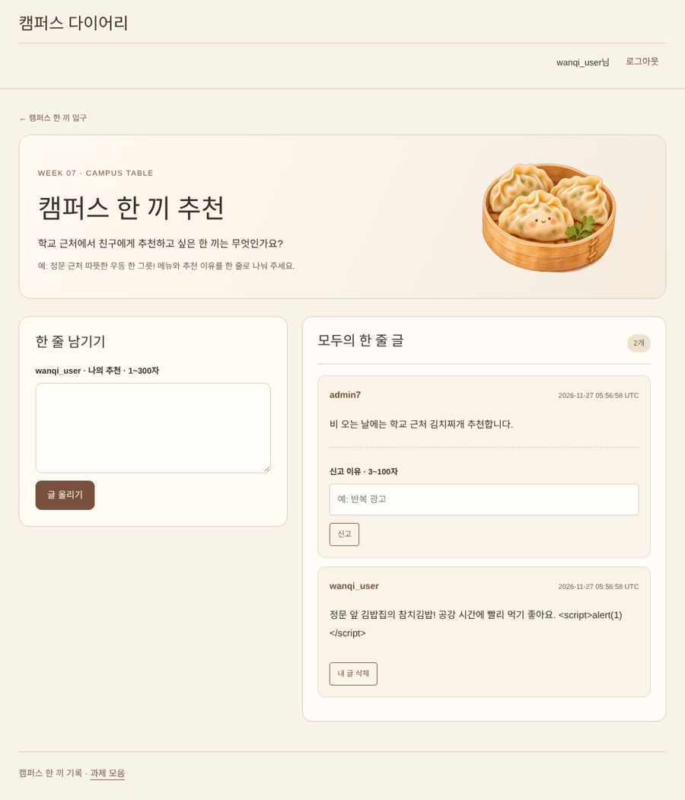
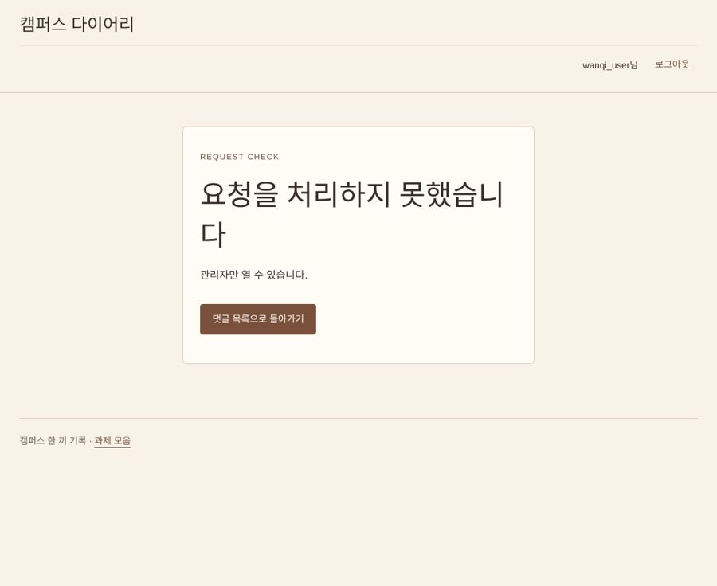
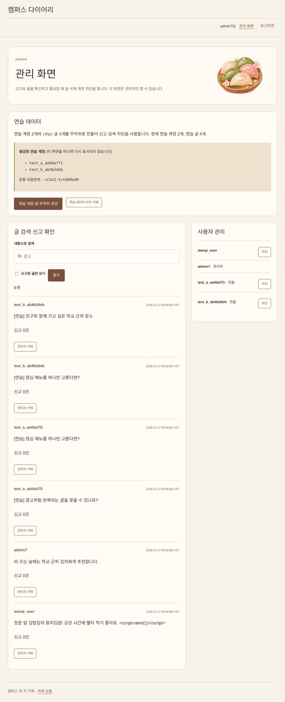
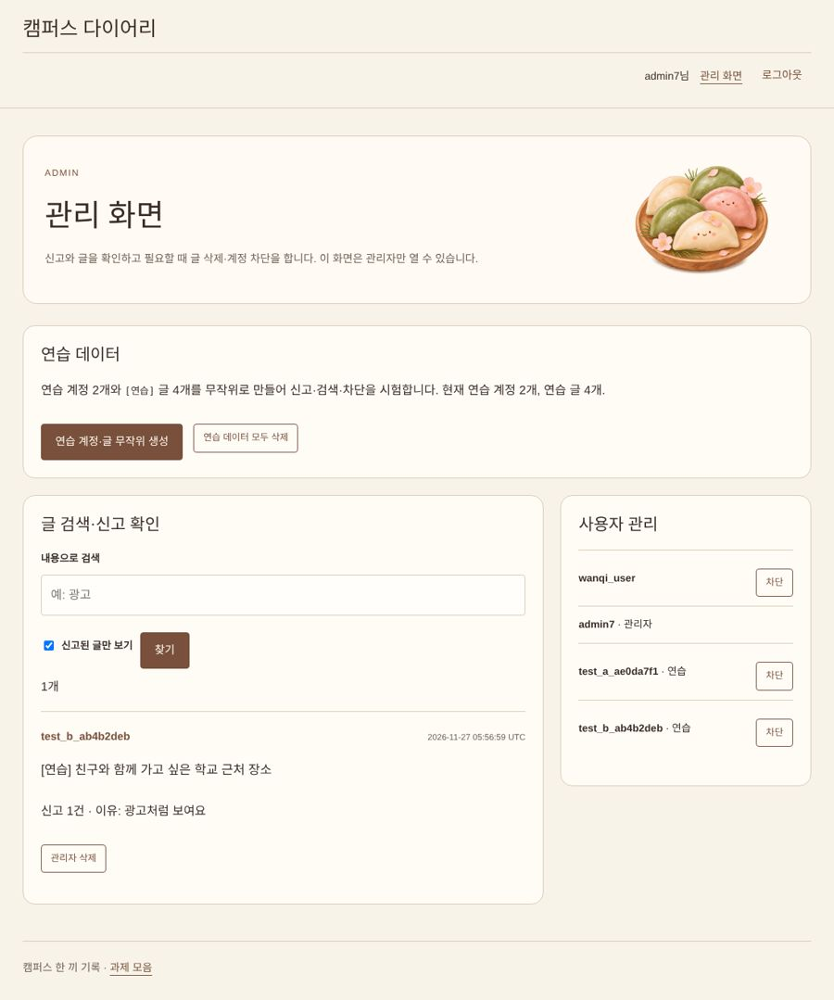
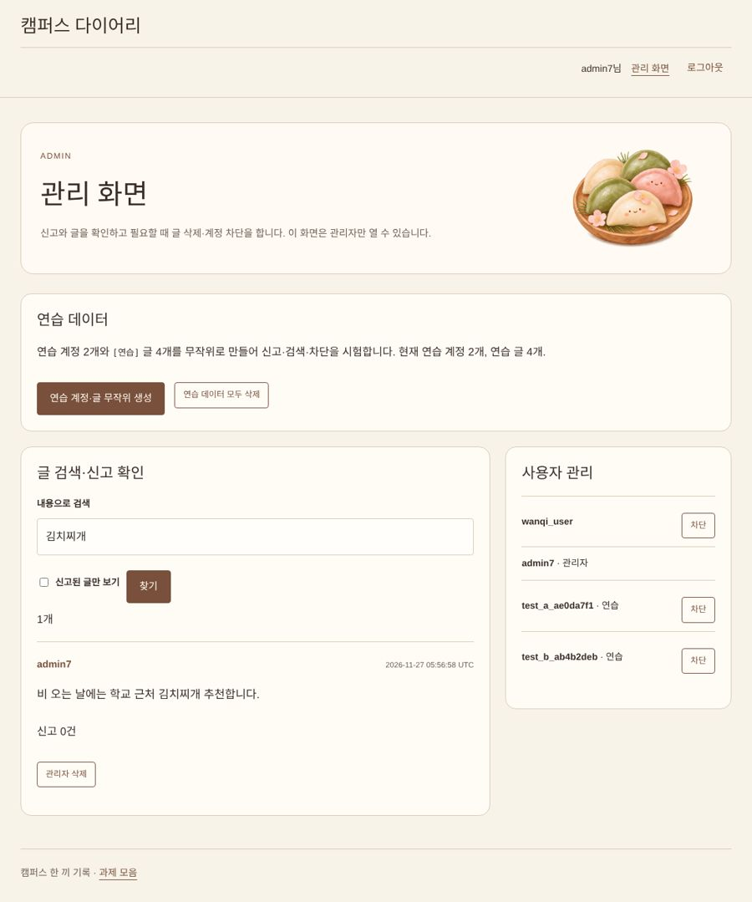
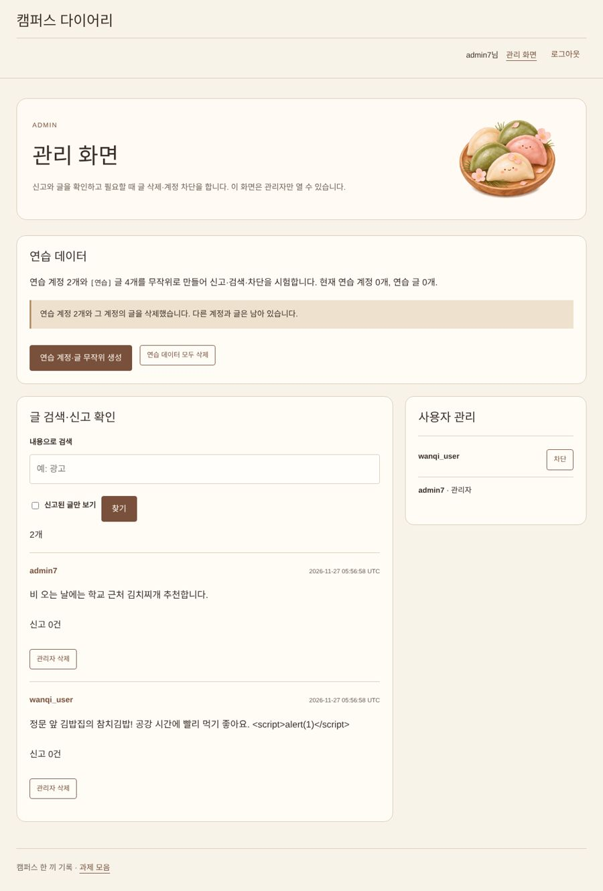
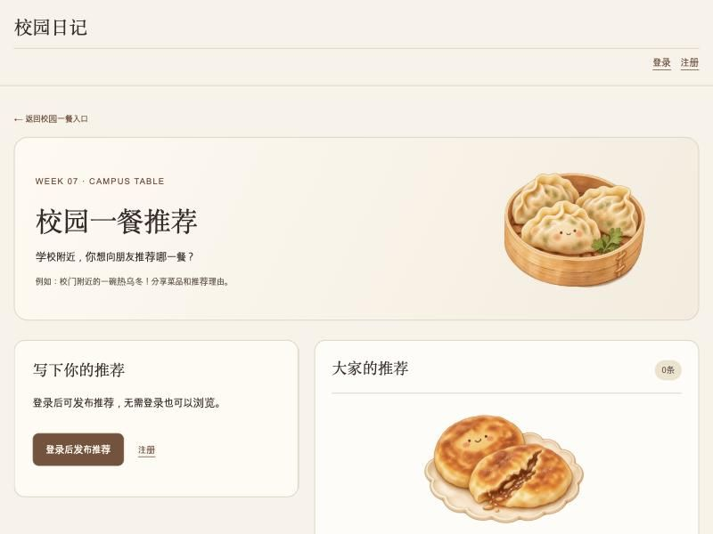

위 관리 기능 화면은 로컬 서버에서 찍었습니다. Render 무료 서버의 SQLite는 재시작·재배포 때 초기화될 수 있습니다.

### Render 배포

- Root Directory: 7주차 소스 폴더(Render 설정 화면의 값)
- Build: `pip install -r requirements.txt`
- Start: `python -m flask --app app init-db && python -m flask --app app ensure-admin && gunicorn app:app --bind 0.0.0.0:$PORT --workers 1 --threads 2`
- 환경변수: `SECRET_KEY`, `WEEK7_ADMIN_USERNAME`, `WEEK7_ADMIN_PASSWORD`(12자 이상), `APP_HTTPS=1`, `PYTHON_VERSION=3.12.12`
- 관리자 ID·PW는 사이버캠퍼스 제출란에만 적고, 이 저장소·README·스크린샷에는 넣지 않습니다. `SECRET_KEY`, `instance/app.db`, `.env`는 `.gitignore`로 올리지 않습니다.

---

## AI 활용 기록

- 도움받은 작업: 4주차 공개 데이터 선택과 CSV 정리, 5주차 저장 데이터 보기·식사 템포 기능, 7주차 연습 데이터 관리 화면 복원, 6·7주차 동작 확인과 README 정리.
- 대표 질문: “제 과제가 각 주차 요구사항을 만족하는지 확인하고 부족한 부분을 고쳐 주세요.”
- 직접 수정·검증한 내용: Google Trends 원본·52주 필터·월평균을 대조, 휴대폰 크기 화면에서 두 탭 확인, 5주차 새로고침·새 탭·삭제 확인, 7주차 두 계정으로 권한 확인.
- 비밀번호, 토큰, 개인 사진은 AI에 보내지 않았습니다.


## 2026-11-27 저장·배포·관리 보완

- 5주차: `week5.draft`는 현재 탭 sessionStorage에 ID·버전·닉네임·문항·답변을 JSON으로 저장합니다. `week5.history`는 localStorage에 완료 ID·버전·전체 답변·결과·시각을 최근 20개까지 저장합니다. 같은 참여 ID는 중복 저장하지 않습니다. 기존 완료 기록은 남기되 버전·답변이 없는 기록은 친구 비교에서 제외합니다. 식사 템포 결과는 유지했습니다.
- 내 저장 데이터 화면은 버튼을 누를 때 저장소를 다시 읽습니다. 전체 삭제는 이 게임의 두 키와 현재 메모리·화면만 지우며 다른 주차나 언어 설정은 건드리지 않습니다. 새로고침 후 이어하기, 결과 재방문, 버전·자료형 검증과 저장 제한 안내를 보완했습니다.
- 6주차: 기존 Render 이미지 서비스를 재검증했습니다. 생성한 단색 JPEG로 흑백·엣지·블러 세 기능과 크기 256/1024px·커널 3/31 조합을 검사했습니다. 실제 측정 기록은 `网页/week6/evidence/render-image-timings.csv`입니다. 네트워크·서버 상태에 따라 시간이 달라지므로 일반 성능으로 단정하지 않습니다. 개인 사진은 사용하지 않았습니다.
- 7주차: 최신 3개 언어 관리자 화면을 보존하고 무작위 샘플을 캠퍼스 한 끼 추천으로 맞췄습니다. 테스트용 임시 SQLite에서 관리자만 생성 가능, CSRF 누락 거부, 연습 계정 2개/추천 4개 생성, 정리 후 실제 계정·글 보존을 확인했습니다. 실제 운영 데이터로 생성·삭제 테스트를 실행하지 않았습니다.
- 수업 요구 확인: https://cg.catholic.ac.kr/~mgchoi/WP/weeks/week04/ (05/06/07도 동일 경로)


## 모바일 form·연습 데이터 보완

- 6주차: 일반 form 버튼도 사진을 먼저 준비한 뒤 실제 브라우저 form POST로 PNG 결과를 엽니다. 4032×3024 테스트 사진이 1600×1200으로 제출되는 것을 확인했습니다. fetch 결과 표시 방식과는 구분합니다.
- 7주차: 메뉴·식사 상황·추천 이유·팁을 조합한 가상 추천을 만듭니다. 2계정/4추천을 유지하며 한국어·中文·English를 지원하고 기존 연습 글과 같은 내용은 피합니다. 선택적으로 연습 글에 모의 신고 1건을 넣어 관리자 필터를 시험할 수 있습니다. 실제 이용자 글에는 모의 신고를 넣지 않습니다.

