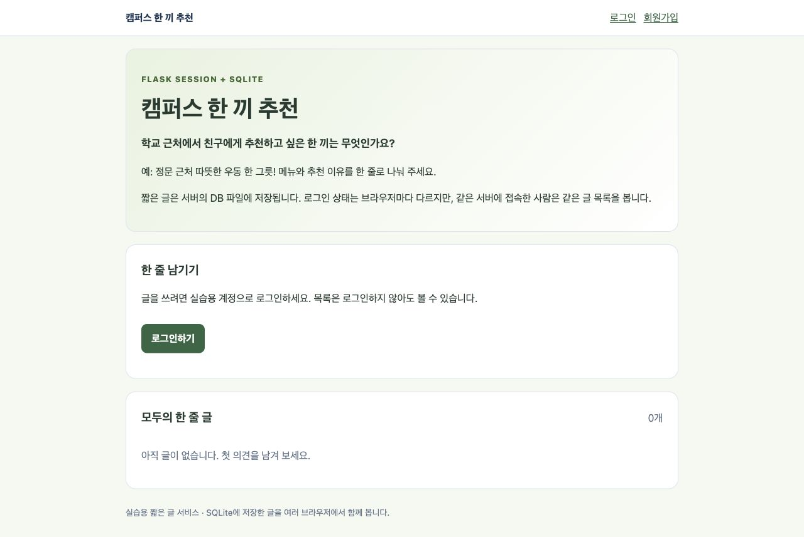
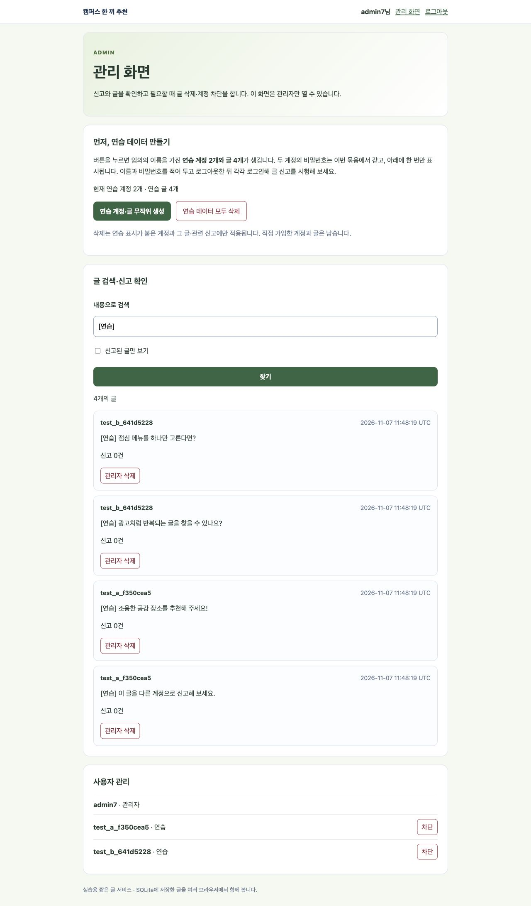
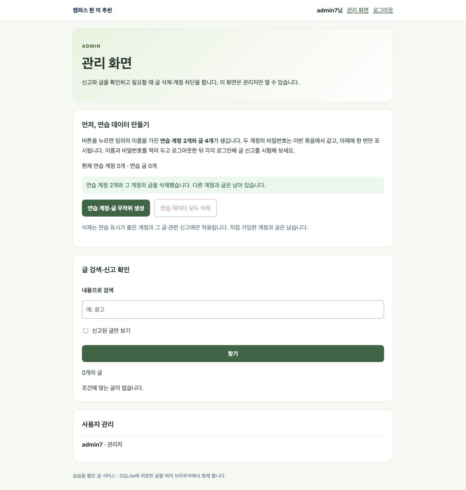

# 7주차 - 학교 근처 음식 추천

학교 근처에서 먹을 만한 음식을 추천하는 게시판입니다.
수업 예제 코드를 바탕으로 만들었습니다.

사이트: https://campus-meal-week7.onrender.com/

## 바꾼 부분

- 게시판 제목과 질문을 음식 추천 주제로 바꿨습니다.
- 예시 문장을 넣었습니다.
- CSS는 회색 배경, 흰색 글 영역, 연한 초록색 버튼으로 간단하게 바꿨습니다.

## 기능과 확인한 내용

회원가입과 로그인이 됩니다. 로그인하면 글을 쓰고 자기 글을 삭제할 수 있습니다.
다른 사람의 글은 신고할 수 있습니다.

두 계정으로 같은 글 목록을 볼 수 있고, 남의 글 삭제는 거부되는 것을 테스트했습니다.
잘못된 비밀번호, 중복 아이디, CSRF 값 없는 요청도 확인했습니다.

관리자는 글 검색, 신고된 글 확인, 글 삭제, 계정 차단과 해제를 할 수 있습니다.
연습 계정과 글을 만들고 정리하는 기능도 있습니다.
Render에서 관리자 로그인, 검색, 연습 데이터 생성과 정리를 확인했습니다.

## 로컬 실행

Python 3.12 환경에서 실행합니다. SECRET_KEY는 환경변수로 설정합니다.

```sh
cd week7
python -m pip install -r requirements.txt
export SECRET_KEY=$(python -c "import secrets; print(secrets.token_hex(32))")
python -m flask --app app init-db
python -m flask --app app run --debug --port 5007
```

주소: http://127.0.0.1:5007/

## Render 설정

- Root Directory: week7
- Build Command: pip install -r requirements.txt
- Python: 3.12.12, Free 사용
- 환경변수: SECRET_KEY, WEEK7_ADMIN_USERNAME, WEEK7_ADMIN_PASSWORD, APP_HTTPS=1

Start Command:

```sh
python -m flask --app app init-db && python -m flask --app app ensure-admin && gunicorn app:app --bind 0.0.0.0:$PORT --workers 1 --threads 2
```

관리자로 로그인한 뒤 위쪽의 관리 화면을 누르면 됩니다.
관리자 ID와 비밀번호는 과제 제출란에 따로 적습니다.
DB, 비밀번호, SECRET_KEY는 GitHub에 올리지 않았습니다.
무료 서버라 처음 열 때 시간이 걸릴 수 있고 재배포하면 DB가 초기화될 수 있습니다.

## 화면

아래는 기본 기능을 배포하고 확인할 때의 화면입니다. 이후 CSS와 문구를 간단하게 수정했습니다.





## AI 사용

예제 실행 오류 확인, CSS 수정, 기능 테스트와 Render 배포에 도움을 받았습니다.
